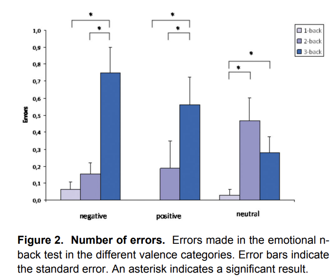

<!--
PSYCH 251 replication report template.

Every project uses this structure so that reports are comparable across the class. They
become public supplementary material, so write for a reader who has the original paper but
not your repository.

The project has two phases, and so does this report:
  Phase 1, the replication. Introduction and Methods are written, critiqued and preregistered
           BEFORE data collection; the Methods addendum, Results and Discussion after it.
  Phase 2, the extension. Proposed after Phase 1 (Rationale, Changes from Phase 1, Power and
           sample, Analysis plan), then run, with its own Results and Discussion.
The AI use statement and the Key statistics table sit at the top and are kept current
throughout. Follow the Extension guidelines page on Canvas for Phase 2.

Render this file at every stage. Before a phase has data, its results say so and skip
themselves; during Pilot A the Phase 1 results run on pilot data, which is the point of Pilot A.

Grey "Guidance" boxes are instructions. Delete each one once you have written that section.
The code is wired to the template's demo experiment (the framing problem). Replace the demo
specifics with your study's as you go: the experiment ids, the original study's numbers, the
exclusion rule, and the key comparison.
-->

```{r}
#| label: setup
#| include: false
library(tidyverse)
library(jsonlite)

# Must match EXPERIMENT.id in experiment.js, and the --experiment you passed to the export.
# Phase 2 runs under its own id, so its data never mix with Phase 1's.
experiment_id        <- "pilot-b"
experiment_id_phase2 <- "framing-demo-phase2"
```

```{r}
#| label: original-study
#| include: false
# Kopf et al. (2013), Results: "2. Behavioral Results" (p. 5).
# Valence × difficulty interaction on errors:
# F(2.8, 82.1) = 3.7, p = .016.
# Degrees of freedom are Greenhouse–Geisser corrected.
# Analysed N = 30, reported in Materials and Methods: "1. Participants" (p. 2).

original <- tibble(
  N         = 30,
  statistic = 3.7,
  df1       = 2.8,
  df2       = 82.1,
  p         = .016
)
```

::: {.callout-note appearance="simple" icon=false}
## Project links

- **Original paper:** Kopf, J. et al. (2013). The Effect of Emotional Content on Brain Activation and the Late Positive Potential in a Word n-back Task. *PloS One*. 2013 Sep 26;8(9):e75598. <https://doi.org/10.1371/journal.pone.0075598>
- **Preregistration:** [OSF registration](https://osf.io/XXXXX) *(registered YYYY-MM-DD, before final data collection)*
- **Live experiment:** < https://psych251.github.io/kopf2013/> (take the study exactly as participants did)
- **Repository:** <https://github.com/psych251/kopf2013> (experiment code, data, and this report)
:::

# AI use statement

| Tool and model | What it was used for | How you checked the output |
|---|---|---|
| ChatGPT(GPT-6.1 Sol Medium) | Brainstormed project ideas and relevant papers to choose to replicate given my personal research interests | Verified citations produced by ChatGPT by manually searching on Google Scholar; compared suggested papers with personal selections; read through each paper |
|ChatGPT(GPT-6.1 Sol Medium) | Helped edit code in R for creating key statistics and power analysis table | Confirmed output via manual code review |
|ChatGPT(GPT-6.1 Sol Medium) | Searched for English language databases to use rated on valence and arousal | Downloaded relevant papers and chose paper to use English word list from |
|ChatGPT(GPT-6.1 Sol Medium) | Generated list of 30 English words to use as stimuli for study, matching words from Warriner et al. to Berlin Affective Word List from original study (z-scored both scales, then matched as similar as possible) | Cross-checked valence numbers with CSV file downloaded as supplementary file from Warriner et al.; manually checked word/syllable length |
|ChatGPT(GPT-6.1 Sol Medium) | Generated list of 30 neutral English words to use as stimuli for the practice study, using words fro Warriner et al. | Cross-checked valence numbers with CSV file downloaded as supplementary file from Warriner et al.; manually checked word/syllable length |
|Claude(Opus 5.5 Medium) | Edited experimental paradigm from demo to fit paradigm from original study as closely as possible | Manually reviewed code before committing to github in a separate branch, then tested the study as a participant before merging branch to main |
|Claude(Opus 5.5 Medium)| Added temporary 'debug' buttons to skip thorugh experiment for debugging purposes; will be inactivated before actually deploying study | Manually reviewed code and went through github pages link to make sure the buttons functioned as expected.|
|ChatGPT(GPT-6.1 Sol Medium) | Edited analysis code sections of replication report to match analysis structure of my study | Manually reviewed code and ensured output was as expected |

I wrote all of the text in this report myself. AI tools were not used to write, rewrite or
paraphrase it, and were not used to generate, alter, or impute any participant data. I take full
responsibility for the content of this report, including any errors introduced by AI tools.

# Key statistics


```{r}
#| label: analysis-functions
#| code-summary: "Show the analysis code (shared by Phase 1 and Phase 2)"

# Requires tidyverse and afex.

# Load exported data and adapt column names to the analysis functions.
# Returns NULL if that phase has not been exported yet.
read_phase <- function(id) {
  dir <- file.path("..", "data", "raw", id)
  if (!all(file.exists(file.path(dir, c("participants.csv", "trials.csv"))))) return(NULL)

  participants <- read_csv(file.path(dir, "participants.csv"), show_col_types = FALSE)
  trials <- read_csv(file.path(dir, "trials.csv"), show_col_types = FALSE) |>
    mutate(
      task = recode(task, "nback" = "n_back"),
      practice = phase == "practice",
      block_id = block,
      is_target = as.logical(is_target),
      responded = as.logical(responded),
      correct = as.logical(correct)
    )

  errors_path <- file.path(dir, "errors.csv")
  errors <- if (file.exists(errors_path)) read_csv(errors_path, show_col_types = FALSE) else tibble()

  complete <- participants |> filter(completed)

  main <- trials |>
    filter(task == "n_back", practice == FALSE)

  if (anyNA(main$is_target) || anyNA(main$responded)) {
    stop("Every main-task trial needs valid is_target and responded values.")
  }

  nb <- main |>
    group_by(participant_id) |>
    summarise(
      n_responses = sum(responded),
      n_non_target = sum(!is_target),
      n_false_alarms = sum(responded & !is_target),
      .groups = "drop"
    ) |>
    mutate(
      false_alarm_rate = if_else(
        n_non_target > 0,
        n_false_alarms / n_non_target,
        NA_real_
      )
    )

  checked <- complete |>
    left_join(nb, by = "participant_id") |>
    mutate(
      n_responses = coalesce(n_responses, 0L),
      no_response = n_responses == 0,
      excessive_responses = false_alarm_rate > 0.80
    )

  if (any(checked$n_responses > 0 & is.na(checked$false_alarm_rate))) {
    stop("Cannot evaluate exclusions: a responding participant has no recorded non-target trials.")
  }

  # Exclude completed participants with no main-task responses or
  # responses on more than 80% of main-task non-target trials.
  keep <- checked |>
    filter(!no_response, !(excessive_responses %in% TRUE))

  list(
    participants = participants,
    trials = trials,
    errors = errors,
    complete = complete,
    checked = checked,
    keep = keep
  )
}

# Error counts per block, averaged across blocks within each participant's
# valence × difficulty condition.
# The original paper does not clearly specify this aggregation step.
error_counts <- function(d) {
  d$trials |>
    filter(task == "n_back", practice == FALSE,
           participant_id %in% d$keep$participant_id) |>
    mutate(valence = factor(valence, levels = c("negative", "positive", "neutral")),
           n_back = factor(n_back, levels = c(1, 2, 3))) |>
    group_by(participant_id, valence, n_back, block_id) |>
    summarise(errors = sum(correct == FALSE), .groups = "drop") |>
    group_by(participant_id, valence, n_back) |>
    summarise(errors = mean(errors), .groups = "drop")
}

# Key test: valence × difficulty interaction in a 3 × 3 repeated-measures ANOVA.
# Apply Greenhouse–Geisser only when Mauchly's test indicates violated sphericity.
interaction_test <- function(counts) {
  N <- n_distinct(counts$participant_id)

  if (N < 2) {
    message("ANOVA skipped: fewer than two analysed participants.")
    return(NULL)
  }

  tryCatch({
    fit <- afex::aov_ez(
      id = "participant_id",
      dv = "errors",
      data = as.data.frame(counts),
      within = c("valence", "n_back"),
      anova_table = list(correction = "none", es = "none")
    )

    mauchly_p <- NA_real_
    correction <- "none"

    if (N >= 5) {
      sphericity <- tryCatch(
        suppressWarnings(
          summary(
            fit$Anova,
            multivariate = FALSE,
            univariate = TRUE
          )$sphericity.tests
        ),
        error = function(e) NULL
      )

      if (!is.null(sphericity) &&
          "valence:n_back" %in% rownames(sphericity)) {
        mauchly_p <- sphericity["valence:n_back", "p-value"]
      }
    }

    if (is.finite(mauchly_p)) {
      correction <- if (mauchly_p < .05) "GG" else "none"
    } else {
      message("Mauchly's test unavailable: reporting an uncorrected pilot ANOVA.")
    }

    tab <- as.data.frame(
      anova(fit, correction = correction, es = "none")
    )
    interaction <- tab["valence:n_back", , drop = FALSE]

    if (!is.finite(interaction[["F"]]) ||
        !is.finite(interaction[["Pr(>F)"]])) {
      message("ANOVA skipped: the interaction F statistic or p value is undefined.")
      return(NULL)
    }

    tibble(
      N = N,
      statistic = interaction[["F"]],
      df1 = interaction[["num Df"]],
      df2 = interaction[["den Df"]],
      p = interaction[["Pr(>F)"]],
      mauchly_p = mauchly_p,
      correction = correction
    )
  }, error = function(e) {
    message("ANOVA skipped: ", conditionMessage(e))
    NULL
  })
}

# Mean error counts and ±1 SE across participants.
error_se <- function(x) {
  se <- sd(x) / sqrt(length(x))
  tibble(mean_errors = mean(x),
         low = mean(x) - se,
         high = mean(x) + se,
         n = length(x))
}

# Side-by-side figure: supply participant-level tables from error_counts().
comparison_plot <- function(...) {
  studies <- list(...)
  studies <- studies[!map_lgl(studies, ~ is.null(.x) || nrow(.x) == 0)]

  if (length(studies) == 0) {
    return(ggplot() + labs(title = "No analysed data yet"))
  }

  df <- imap_dfr(studies, ~ mutate(.x, Study = .y)) |>
    group_by(Study, valence, n_back) |>
    summarise(error_se(errors), .groups = "drop") |>
    mutate(Study = factor(Study, levels = names(studies)))

  dodge <- position_dodge(width = 0.8)

  ggplot(df, aes(x = valence, y = mean_errors, fill = n_back)) +
    geom_col(position = dodge, width = 0.75) +
    geom_errorbar(aes(ymin = low, ymax = high),
                  position = dodge, width = 0.2, na.rm = TRUE) +
    facet_wrap(~ Study) +
    scale_fill_manual(
      values = c("grey85", "#9997C5", "#316AA8"),
      labels = c("1-back", "2-back", "3-back")
    ) +
    labs(x = "Word valence", y = "Mean number of errors per block",
         fill = "Difficulty") +
    theme_minimal(base_size = 12) +
    theme(legend.position = "top")
}

phase1 <- read_phase(experiment_id)
phase2 <- read_phase(experiment_id_phase2)
have_data   <- !is.null(phase1)
have_phase2 <- !is.null(phase2)
```

```{r}
#| label: key-stats
#| echo: false

fmt_row <- function(study, r) {
  if (is.null(r)) {
    return(tibble(Study = study, N = "", `ANOVA comparison` = "valence * difficulty",
                  `F` = "", `df1` = "", `df2` = "", p = ""))
  }
  tibble(Study = study, N = as.character(r$N),
         `ANOVA comparison` = "valence * difficulty",
         `F` = sprintf("%.2f", r$statistic),
         `df1` = sprintf("%.2f", r$df1),
         `df2` = sprintf("%.2f", r$df2),
         p = format.pval(r$p, digits = 2, eps = 0.001))
}
bind_rows(
  fmt_row("Original", original),
  fmt_row("Phase 1: replication", if (have_data) interaction_test(error_counts(phase1))),
  fmt_row("Phase 2: extension", if (have_phase2) interaction_test(error_counts(phase2)))
) |>
  knitr::kable(align = "lrlrrrr",
               caption = "Key comparison: valence × difficulty interaction on error counts in a 3 × 3 repeated-measures ANOVA. Original degrees of freedom are Greenhouse–Geisser corrected. Replication results use the correction when Mauchly's test indicates violated sphericity (p < .05).")
```

# Phase 1: Replication

## Introduction

&emsp; The empirical article by Kopf et al. “The effect of emotional content on brain activation and the late positive potential in a word n-back task,” published in PLoS One in 2013, tests the hypothesis that emotional words, particularly the valence of those words, impact working memory performance. The authors found that across different blocks of the n-back task where the stimuli consisted of either positive, negative, or neutral words (which varied only by valence level, not by arousal level), more errors were made one difficult tasks when the valence was negative. I plan to replicate the main finding of the paper displayed in Figure 2 regarding errors made in the n-back test in different valence categories. This finding has relevance for my broader research interests that span not only the fundamental mechanisms underlying cognitive control, but also the factors that influence cognitive control performance, including mental health conditions and general emotional states. My first-year project involves investigating subcortical brain regions involved in a variety of cognitive control domains; one of the tasks in the dataset I am utilizing from my lab is a version of the n-back, the same task utilized in this study. Replicating this project will allow me to gain more foundational knowledge of this task paradigm as I implement the design in Javascript and motivate me to consider key considerations of how to analyze behavioral results from this task.

&emsp; The procedure described in the paper involves using words from the Berlin Affective Word list, which are classified for arousal and valence, and also matched for properties like word length, as stimuli in various blocks of the n-back task. There were 27 blocks in the task, three blocks of each of the conditions described next: a 1-back task with negative-valenced words as stimuli, a 2-back task with negative-valenced words as stimuli, and a 3-back task with negative-valenced words as stimuli; a 1-back task with neutral-valenced words as stimuli, a 2-back task with neutral-valenced words as stimuli, and a 3-back task with neutral-valenced words as stimuli; a 1-back task with positive-valenced words as stimuli, a 2-back task with positive-valenced words as stimuli, and a 3-back task with positive-valenced words as stimuli. A challenge I forsee is matching the words from the Berlin Affective Word list with English-equivalent words. I will have to find a similar word list that rates words on valence and arousal, as the English-translated versions of the words used in this study might not be sufficient, or might not be matched on word length, etc.

&emsp; The key statistical test I will pre-register is collect each participant’s RT and error rates on the blocks, then run a 3 (emotional valence of word) * 3 (difficulty level of task) repeated ANOVA. The test is the interaction effect of word valence on error rate. The original study reported the results as such: “A significant interaction effect for the errors (F(2.8, 82.1) = 3.7, p = .016) was observed, indicating that word valence influenced the error rate differentially in each difficulty level, the more difficult the task; the more errors were made especially in the negative valence condition.” A possible extension I might complete for this study if it does not replicate is trying to recruit German speakers on Prolific to complete the task, and use the exact same words from the Berlin Affective Word list as in the original paper. I will use a first-language screener in Prolific, which might take a bit longer to recruit people to complete the task.

## Methods

### Power analysis

```{r}
#| label: power

# Assumptions: same standardized interaction effect and Greenhouse–Geisser
# epsilon as the original study. Results are approximate and depend on
# these assumptions. Uses original statistics defined in original-study.
# This approximates the GG-corrected test, rather than the complete
# Mauchly-based conditional-correction procedure.

original_effect <- original$statistic * original$df1 / original$df2
epsilon <- original$df2 / (4 * (original$N - 1))

power_at <- function(n) {
  df1 <- 4 * epsilon
  df2 <- 4 * (n - 1) * epsilon
  critical_f <- qf(0.95, df1, df2)

  pf(critical_f, df1, df2,
     ncp = original_effect * df2, lower.tail = FALSE)
}

power_rows <- map_dfr(c(0.80, 0.90, 0.95), function(pw) {
  n <- uniroot(function(n) power_at(n) - pw,
               interval = c(2, 10000))$root
  tibble(power = scales::percent(pw),
         n_per_condition = ceiling(n),
         n_total = ceiling(n))
})

two_and_half <- ceiling(2.5 * original$N)

knitr::kable(power_rows,
             col.names = c("Power", "N per condition", "N total"),
             caption = sprintf(
               paste0(
                 "Approximate sample needed for the valence × difficulty interaction, ",
                 "assuming the original standardized effect (partial f² = %.3f) ",
                 "and Greenhouse–Geisser epsilon = %.2f, alpha = .05. ",
                 "All participants complete all nine conditions."
               ),
               original_effect, epsilon))
```


The original sample size was intended to be 32 participants, but 2 were excluded, for a final sample size of 30 participants. The original effect size was F(2.8, 82.1) = 3.7 (which we can calculate as partial f2 = 0.126). The table above shows the sample size needed to detect this effect size. In this instance, 2.5 times the original sample would be 75 participants (per condition and total, since this is a within-participant study). We will use the 2.5 times original sample method and recruit 75 participants. Since the task takes about 25 minutes and is $10 per hour, the budget will be around $312.50 for the first replication.

### Planned sample

The planned sample is US residents on Prolific, fluent in English, 18 or older. There are no filtering questions for the first replication.
The planned sample size is 75 participants, following the 2.5* original sample rule that is a widely-used alternative to using the original sample size (Simonsohn, 2015). I will collect until 75 participants pass the exclusion criteria described below in the Analysis plan (i.e., 75 participants that actually completed the experiment correctly and paid attention).

### Materials

- The n-back task structure is identical to the original article, quoted here: "Participants saw blocks of ten consecutive words presented
on a computer screen. Two of these words were used as cues
and were followed by a target word which was presented one,
two or three words after the cue word, to vary the difficulty level
and thus the working memory load. When the participants saw
the target word, they were instructed to press the space key on
a standard keyboard. Each block of ten words comprised one
difficulty level. Also the emotional content of the words was
varied; the words were positive, negative or neutral. Each block
encompassed only one emotional valence. In total, there were
three blocks where the emotional valence was negative and
the difficulty level was one, meaning the target word followed
the cue word directly. Three blocks had a negative emotional
valence and the difficulty level was two, meaning there was
one word between cue word and target word. Three blocks had
a negative emotional valence and the difficulty level was three,
meaning there were two words between the cue word and the
target word. The same was true for the positive and the neutral
emotional valence; therefore, in sum the experiment had 27
blocks. Each block was 20 seconds long, and blocks were
separated by a 20-second pause. Within each block, each
word was visible for 500 ms, followed by a blank screen, which
was also 500 ms long. The difficulty level of the blocks was
pseudorandomized, and difficulty levels always varied from one
block to another. In the pause preceding a block, the instruction
for the task (1-, 2-, 3-back) was presented on the screen."

- The words in the original study were as follows: "The words (a list of which can be seen in Table 1) were
chosen from the Berlin Affective Word List [11], were all nouns
and matched for valence (positive nouns had a mean valence
of 2, negative nouns a mean valence of -2 and neutral words a
mean valence rating of 0, with the valence scale spanning from
-3 for very negative to 3 for very positive). Mean arousal of
emotional words was matched in respect of their valence,
meaning the negative and positive words had a mean arousal
of 3, the neutral words had a mean arousal of 0 (on a scale
from 1: very low arousal to 5: very high arousal). To ensure
equal working memory load for all words, phoneme length (5),
syllable length (2), and number of letters (6) were matched as
well." Negative words with their English translations were: "TYPHUS (typhus), BEFEHL (order), ARREST (warrant), TYRANN (tyrant), GREUEL (horror), SEENOT (distress at sea), HORROR (horror), TRAUMA (trauma), TERROR (terror), and UNHEIL (calamity)". Positive words were "RETTER (savior), WISSEN (knowledge), MUTTER (mother), GEWINN (win), GEFÜHL (feeling), HIMMEL (heaven), FRIEDE (peace), URLAUB (vacation), SOMMER (summer), and FREUND (friend)". Neutral workds were: "ABLAUF (sequence), AFFEKT (affect), BANNER (banner), GERUCH (smell), KELLER (basement), LOSUNG (watchword), STELLE (position), ZEUGIN (eye witness), AKZENT (accent), and INHALT (content)."

- We used as close to equivalent words in English as possible, matched on the same valence/arousal conditions and matched on phoneme/word length as in the original study. Words were taken from Warriner et al.'s "Norms of valence, arousal, and dominance for 13,915 English lemmas" (https://doi.org/10.3758/s13428-012-0314-x) (downloaded supplementary CSV file with words and their ratings). We asked Chatgpt (GPT-6.2 Sol Medium) to come up with a list of words with similar arousal/valence as the German words in the original study (z-scored the scales to then compare their ratings), and matched on word length, etc., then verified the output by checking the CSV itself and the original paper to see if it matched the original study. Please see the tables below for the word lists. Note that English words use a 1-9 scale, as opposed to the -3 to +3 valence scores of the Berlin Affective Word List, which is why we had ChatGPT do z-scoring for the comparison with the German word list.

| Negative word | Valence | Arousal | Valence z | Arousal z |
|---|---:|---:|---:|---:|
| trauma | 2.89 | 4.87 | -1.705 | 0.736 |
| deceit | 2.89 | 5.62 | -1.705 | 1.572 |
| lesion | 2.95 | 5.62 | -1.658 | 1.572 |
| maggot | 2.00 | 5.60 | -2.403 | 1.550 |
| hazard | 2.90 | 5.77 | -1.697 | 1.740 |
| danger | 2.66 | 5.84 | -1.886 | 1.818 |
| famine | 2.95 | 6.10 | -1.658 | 2.108 |
| battle | 3.52 | 6.25 | -1.211 | 2.275 |
| spider | 3.35 | 6.91 | -1.344 | 3.011 |
| zombie | 3.57 | 6.53 | -1.172 | 2.587 |

| Positive word | Valence | Arousal | Valence z | Arousal z |
|---|---:|---:|---:|---:|
| access | 6.68 | 5.30 | 1.268 | 1.215 |
| orchid | 7.00 | 4.11 | 1.519 | -0.112 |
| muffin | 7.10 | 4.05 | 1.597 | -0.179 |
| riches | 7.10 | 5.42 | 1.597 | 1.349 |
| yogurt | 7.00 | 4.52 | 1.519 | 0.345 |
| season | 6.71 | 3.20 | 1.291 | -1.127 |
| vision | 6.79 | 3.18 | 1.354 | -1.150 |
| silver | 7.48 | 4.00 | 1.895 | -0.235 |
| cuddle | 7.60 | 3.83 | 1.989 | -0.425 |
| kitten | 7.58 | 3.19 | 1.974 | -1.139 |

| Neutral word | Valence | Arousal | Valence z | Arousal z |
|---|---:|---:|---:|---:|
| domain | 5.05 | 3.36 | -0.011 | -0.949 |
| cannon | 4.74 | 5.09 | -0.254 | 0.981 |
| module | 4.90 | 4.33 | -0.129 | 0.133 |
| fiddle | 5.05 | 4.05 | -0.011 | -0.179 |
| gender | 5.05 | 4.05 | -0.011 | -0.179 |
| method | 5.20 | 4.17 | 0.107 | -0.045 |
| duffel | 4.90 | 3.50 | -0.129 | -0.793 |
| tassel | 4.95 | 4.78 | -0.089 | 0.635 |
| copter | 4.86 | 4.70 | -0.160 | 0.546 |
| retail | 5.00 | 3.62 | -0.050 | -0.659 |

| Category | Mean valence | Mean arousal | Mean valence z | Mean arousal z |
|---|---:|---:|---:|---:|
| Negative | 2.968 | 5.911 | -1.644 | 1.897 |
| Positive | 7.104 | 4.080 | 1.600 | -0.146 |
| Neutral | 4.970 | 4.165 | -0.074 | -0.051 |


### Procedure

- First, the participant views the consent screen and consents to participate in the study.
- Second, the participant completes a demographics page.
- Third, the participant sees the welcome page orienting them to what they should expect from the study.
- Fourth, the participant goes through a series of instruction screens where they are instructed how to do a 1-back, 2-back, and 3-back task. They are then presented with question that checks their understanding of the instructions. A correct answer will lead to a 'correct' screen, whereas a wrong answer will send them back to instructions.
- Fifth, the participant enters the practice block, which follows the same structure as the original study: "Before the experiment, participants practised the task using
one block of each difficulty (1-, 2-, 3-back). Before the task
itself, completed a training phase, where they saw 30 consecutive neutral words in the 1-back condition, the same
neutral words in the 2-back condition and in the 3-back
condition."
- Sixth, the participant enters the main task block, which follows the same structure as the original study: "Participants saw blocks of ten consecutive words presented
on a computer screen. Two of these words were used as cues
and were followed by a target word which was presented one,
two or three words after the cue word, to vary the difficulty level
and thus the working memory load. When the participants saw
the target word, they were instructed to press the space key on
a standard keyboard. Each block of ten words comprised one
difficulty level. Also the emotional content of the words was
varied; the words were positive, negative or neutral. Each block
encompassed only one emotional valence. In total, there were
three blocks where the emotional valence was negative and
the difficulty level was one, meaning the target word followed
the cue word directly. Three blocks had a negative emotional
valence and the difficulty level was two, meaning there was
one word between cue word and target word. Three blocks had
a negative emotional valence and the difficulty level was three,
meaning there were two words between the cue word and the
target word. The same was true for the positive and the neutral
emotional valence; therefore, in sum the experiment had 27
blocks. Each block was 20 seconds long, and blocks were
separated by a 20-second pause. Within each block, each
word was visible for 500 ms, followed by a blank screen, which
was also 500 ms long. The difficulty level of the blocks was
pseudorandomized, and difficulty levels always varied from one
block to another. In the pause preceding a block, the instruction
for the task (1-, 2-, 3-back) was presented on the screen."
- Seventh, the participant sees a screen with an optional free-text box where they can write any feedback about their participation in the study.
- Last, the participant sees the debrief screen with a 'Finish' button that saves the data.
The entire task is expected to take around 25 minutes.
- The only exception between our study and the original study is adding in particular consent, demographics, feedback, and debrief screens. The task was the same except the words were in English, as described above.

### Analysis plan

**Key analysis of interest.** On more difficult n-back tasks, more errors are made on blocks with negatively-valenced words as stimuli. This is tested as a 3 by 3 (emotional valence of word (positive, negative, neutral) by difficulty of task (easy, medium, hard/1-back, 2-back, 3-back)) repeated within-subjects ANOVA. The reported statistics include the F-value with degrees of freedom and the p-value on the interaction effect of word valence on error rate (the degrees of freedom are corrected with Greenhouse-Geisser method if sphericity is violated as described in the original paper).

**Exploratory analysis.** We also looked at the n-back response times based on valence, as described in the Exploratory analyses section below.

**Exclusions.** The original paper does not report exclusion reasons, other than 2 of the participants were excluded "for technical reasons." I will add additional behavioral checks to exclude participants who appear to have not paid attention at all during the study or attempt to cheat. I will exclude on the condiitons as follows: Pparticipants who never press the response key during any block of the n-back task; participants who respond on more than 80% of non-target trials (i.e., the word they see is NOT the same as the word n trials before)

### Differences from the original study

| Aspect | Original study | This replication | Expected to matter? |
|---|---|---|---|
| Sample | Thirty-two healthy right-handed volunteers (in person), German speakers| Adults recruited on Prolific, English speakers from the U.S.| Possibly. Even if our English words matched the Berlin Affective Word list exactly, cultural differences between German and U.S. participants could elicity varying results |
| Setting | Online task but conducted in person; participants wore fNIRS equipment and EEG electrodes while completing task | Online, unsupervised, on the participant's own computer, without fNIRS or EEG equipment | Possibly. Wearing the equipment (which is likely uncomfortable) could have some influence on participants' overall n-back task performance |
| Wording | German words from Berlin Affective Word list | English words from Warriner et al. | Unlikely. English words matched conditions of words from original study; they were matched on word and syllable length, arousal, and words were chosen to have equivalent valences to the German word set used in the original study. |
| Design | Within subjects, pseudo-randomized condition order | Within subjects, pseudo-randomized condition order | The study specifies a psuedo-randomized condition order whereby the difficulty level had to vary from one block after the other, so in the replicated study the exact order for each subject will be different than the exact order for each subject in the original study. This is unlikely to have any effect. |
| Response | Keyboard press (space key on standard keyboard) | Keyboard press (space key; however we cannot regulate what kind of keyboard participants have access to at home) | Unlikely. Most participants will probably have a standard keyboard, and any keyboard has a space bar on it.|
| Exclusion criteria | Not specified other than "technical reasons" | Excluded based on participants who never pressed response key during any n-back block, or responded on more than 80% of non-target trials | Unlikely. If the original study included participants who weren't paying attention, then it would have likely made the effect size less significant. However, the original study took place in person, so experimenters would have likely noticed if a participant wasn't paying attention (these checks matter more for our online study on Prolific). |
| Other tasks | Tasks were completed alongside fluid and crystallized intelligence questionnaires, a clinician interview to assess for neuropsychiatric diagnoses, and a emotions/mood questionnaire (PANAS). | Instructions were followed by an instruction comprehension check, all additional surveys were excluded | Unlikely: the instruction check is meant to ensure participants understand the task, not to change any results. Given the within-subjects design for the behavioral result, the additional surveys (intelligence, mood, neuropsychitric diagnoses), which were included in original study to confirm that there were comparable intelligence levels in the sample and that there were no neuropsychiatric diagnoses, should not have any effect on within-subjects ANOVA results. |

### Methods addendum (post data collection)

::: {.callout-tip icon=false}
## Guidance

Leave this section out of the version you preregister. After data collection, report the
actual sample and any deviation from the plan above.
:::

#### Actual sample

```{r}
#| label: no-data-notice
#| echo: false
#| results: asis
if (!have_data) {
  cat(
    "::: {.callout-warning icon=false}\n",
    "## No Phase 1 data yet\n\n",
    "There are no exported data for `", experiment_id, "` yet, so the sample and results ",
    "sections are skipped. This is expected before data collection. Export with ",
    "`npm run export -- --experiment ", experiment_id, " --key <path to your key>` and render again. ",
    "If you have exported, check that `experiment_id` at the top of this file matches ",
    "`EXPERIMENT.id` in `experiment.js`.\n",
    ":::\n", sep = "")
}
```

```{r}
#| label: phase1-data
#| eval: !expr have_data
# Loaded and excluded by read_phase(), under Key statistics, so Phase 1 and Phase 2 share one
# exclusion rule.
participants <- phase1$participants
trials       <- phase1$trials
errors       <- phase1$errors
complete     <- phase1$complete
keep         <- phase1$keep
checked      <- phase1$checked
```

```{r}
#| label: funnel
#| eval: !expr have_data
funnel_levels <- c("Started", "Completed", "Passed exclusion criteria")
bind_rows(
  participants |> mutate(step = "Started"),
  complete     |> mutate(step = "Completed"),
  keep         |> mutate(step = "Passed exclusion criteria")
) |>
  mutate(step = factor(step, levels = funnel_levels)) |>
  count(step, name = "Total", .drop = FALSE) |>
  rename(Step = step) |>
  knitr::kable(caption = "Participants at each step. All analysed participants complete the within-subjects valence × difficulty design.")
```

```{r}
#| label: sample-text
#| eval: !expr have_data
#| echo: false
#| results: asis
cat(sprintf("Of %d participants who started, %d completed the study and %d were retained after exclusions.",
            nrow(participants), nrow(complete), nrow(keep)))

n_no_response <- sum(checked$no_response %in% TRUE)
n_excessive_responses <- sum(checked$excessive_responses %in% TRUE)

if (n_no_response > 0) {
  cat(sprintf(" %d completed session(s) contained no response during the main n-back task and were excluded.",
              n_no_response))
}
if (n_excessive_responses > 0) {
  cat(sprintf(" %d completed session(s) contained responses on more than 80%% of non-target trials and were excluded.",
              n_excessive_responses))
}
if (nrow(keep) == 0) cat(" No participants remain for analysis yet.")
cat("\n")
```

```{r}
#| label: demographics
#| eval: !expr have_data
demo <- trials |>
  filter(task == "demographics", participant_id %in% keep$participant_id) |>
  mutate(resp = map(response, ~ fromJSON(.x))) |>
  transmute(
    participant_id,
    age    = map_dbl(resp, ~ as.numeric(.x$age %||% NA)),
    gender = map_chr(resp, ~ as.character(.x$gender %||% NA))
  )

if (nrow(demo) > 0) {
  demo |>
    summarise(N = n(), `Mean age` = round(mean(age, na.rm = TRUE), 1),
              `SD age` = round(sd(age, na.rm = TRUE), 1),
              `Age not given` = sum(is.na(age))) |>
    knitr::kable(caption = "Age of the analysed sample.")
}
```

#### Deviations from the preregistered plan

::: {.callout-tip icon=false}
## Guidance

Any deviation from the preregistered plan above, or "None". Changes made after seeing data
belong here even if they seem minor, together with the reason.
:::

## Results

### Data preparation

### Confirmatory analysis

```{r}
#| label: confirmatory
#| eval: !expr have_data
counts <- error_counts(phase1)
result <- interaction_test(counts)

if (!is.null(result)) {
  result |>
    transmute(
      N,
      `ANOVA comparison` = "valence × difficulty",
      F = sprintf("%.2f", statistic),
      df1 = sprintf("%.2f", df1),
      df2 = sprintf("%.2f", df2),
      p = format.pval(p, digits = 2, eps = 0.001)
    ) |>
    knitr::kable(
      caption = paste(
        "Confirmatory analysis: valence × difficulty interaction on error counts",
        "in a 3 × 3 repeated-measures ANOVA.",
        "Greenhouse–Geisser correction is applied when Mauchly's test indicates",
        "violated sphericity (p < .05)."
      )
    )
} else {
  message("ANOVA not run: need at least two analysed participants with complete data across all nine conditions.")
}
```

### Replication assessment

::: {.callout-tip icon=false}
## Guidance

Judge the replication on effect sizes, not only on whether the key test is significant. Compare
the replication estimate and its interval with the original: does the interval exclude zero, and
does it include the original estimate? A significant result much smaller than the original, or
a non-significant result whose interval still includes the original effect, are both
informative and should be reported as such (Experimentology §3.2).
:::

```{r}
orig <- original
rep  <- if (have_data) interaction_test(error_counts(phase1)) else NULL

if (!is.null(rep)) {
  bind_rows(orig |> mutate(Study = "Original"), rep |> mutate(Study = "Phase 1: replication")) |>
    transmute(Study, N,
              `Partial eta squared` = sprintf("%.3f",
                (statistic * df1) / (statistic * df1 + df2)),
              F = sprintf("%.2f", statistic),
              df1 = sprintf("%.2f", df1),
              df2 = sprintf("%.2f", df2),
              p = format.pval(p, digits = 2, eps = 0.001)) |>
    knitr::kable(caption = paste(
      "Valence × difficulty interaction on error counts. Original degrees of freedom are Greenhouse–Geisser corrected. Replication results use the correction when Mauchly’s test indicates violated sphericity (p < .05). When Mauchly’s test cannot be estimated, uncorrected replication results are shown for pilot debugging only. Original partial eta squared is reconstructed from rounded published statistics."
    ))
} else {
  message("Replication statistics not computed yet: need at least two analysed participants with complete data across all nine conditions.")
}
```

```{r}
#| label: comparison-verdict
#| eval: !expr have_data
#| echo: false
#| results: asis
if (!is.null(rep)) {
  orig_effect <- (orig$statistic * orig$df1) /
    (orig$statistic * orig$df1 + orig$df2)
  rep_effect <- (rep$statistic * rep$df1) /
    (rep$statistic * rep$df1 + rep$df2)

  cat(sprintf(
    "The replication's valence × difficulty interaction had partial eta squared = %.3f, compared with approximately %.3f in the original study. ",
    rep_effect, orig_effect))

  cat(sprintf(
    "The replication interaction was %s at alpha = .05 (%s). ",
    if (rep$p < .05) "statistically significant" else "not statistically significant",
    format.pval(rep$p, digits = 2, eps = .001) |>
      paste0("p ", if (rep$p < .001) "" else "= ", x = _)))

}
```


::: {layout-ncol=2}



```{r}
#| label: fig-comparison
#| eval: !expr have_data
#| fig-cap: "Phase 1 replication: mean errors per block by word valence and task difficulty. Error bars indicate ±1 SE across participants."
#| fig-width: 6
#| fig-height: 4
comparison_plot(`Phase 1: replication` = error_counts(phase1))
```

:::


### Exploratory analyses

```{r}
#| label: exploratory-rt
#| eval: !expr have_data
nb <- trials |>
  filter(task == "n_back", practice == FALSE,
         participant_id %in% keep$participant_id) |>
  mutate(correct = as.logical(correct),
         is_target = as.logical(is_target),
         rt = as.numeric(rt)) |>
  filter(correct, is_target, is.finite(rt), rt > 0)

if (nrow(nb) > 0) {
  nb |>
    group_by(participant_id, valence, n_back) |>
    summarise(mean_rt = mean(rt), .groups = "drop") |>
    group_by(valence, n_back) |>
    summarise(`Mean RT (ms)` = round(mean(mean_rt)),
              `SD of participant means (ms)` = round(sd(mean_rt)),
              Participants = n(), .groups = "drop") |>
    knitr::kable(caption = "Exploratory: n-back response times for correct targets, averaged within participants before summarizing across participants.")
} else {
  message("No correct n-back target responses with a valid response time yet.")
}
```

```{r}
#| label: data-quality
#| eval: !expr have_data
if (nrow(errors) > 0) {
  errors |> select(any_of(c("at", "trial_index", "message"))) |> head(20) |>
    knitr::kable(caption = "JavaScript errors reported from participants' browsers.")
} else {
  message("No errors were reported from participants' browsers.")
}
```

## Discussion

### Summary of replication attempt

::: {.callout-tip icon=false}
## Guidance

Open with one paragraph summarizing the result of the key analysis and your assessment of
whether the original finding replicated, partially replicated, or failed to replicate. Base
that judgment on the replication assessment above: the size of the effect relative to the
original, not just the p value.
:::

### Commentary

::: {.callout-tip icon=false}
## Guidance

Open-ended commentary, none of it long: (a) what the exploratory analyses suggest; (b) what the
replication means, for example whether the differences between your study and the original are
definitely, plausibly, or unlikely to be moderators of the result; and (c) any objections or
challenges raised by you or the original authors.
:::

# Phase 2: Extension
<!-- Phase 2 code is disabled until this phase begins. -->

::: {.callout-tip icon=false}
## Guidance: choosing your extension

Follow the Extension guidelines page on Canvas. In brief:

- **By default the extension is a best-practices modification of your Phase 1 experiment.** If
  your replication did not succeed, it is a **rescue**: address the plausible reasons for the
  failure. If it did succeed, it is an **upgrade**: make the estimate more precise. Typical
  changes are better or more reliable measurement, more trials, a within-participant design
  where that is legitimate, comprehension and manipulation checks, clearer instructions, or a
  larger or better-targeted sample.
- **If your scientific extension pitch was approved at Milestone 3 and your replication
  succeeded, propose that instead:** the original conditions rerun unchanged, plus the one
  added condition or manipulation, with a power analysis for the new comparison.
- On either track you may add exploratory measures **at the end** of the study.
- Every change is listed and tagged by category below; everything else stays identical.

State your track on the line below, and delete the others.
:::

**Track:** Best-practices upgrade / Best-practices rescue / Scientific extension (approved at Milestone 3)

## Rationale

::: {.callout-tip icon=false}
## Guidance

One or two paragraphs. For a rescue: what are the plausible reasons Phase 1 did not reproduce the
original result, and how does each change address one of them? For an upgrade: where is the
Phase 1 estimate least precise or least trustworthy, and how will the changes improve it? For a
scientific extension: what question does the added condition answer, and why does it follow from
the original finding?
:::

## Changes from Phase 1

::: {.callout-tip icon=false}
## Guidance

Every change from the Phase 1 experiment, one per row, each tagged with a category: Measurement,
Trials, Design, Checks, Instructions, Sample, Added condition (scientific track only), or
Exploratory measure (end of study only). If it is not in this table, it does not change: same
materials, wording, procedure, exclusion rule and analysis. The rows below are examples for the
demo; replace them with yours.
:::

| # | Category | Phase 1 | Phase 2 | Why |
|---|---|---|---|---|
| 1 | Sample | 27 analysed participants | 300 analysed participants (150 per frame) | Phase 1's interval was too wide to distinguish the original effect from a much smaller one. |
| 2 | Checks | No comprehension check | After the choice, participants say how many people are at risk (600) | Confirms participants read the scenario; failures are reported, and excluded only if preregistered. |
| 3 | Exploratory measure | None | At the end: "How confident are you in your choice?" (1–7) | Exploratory only; collected after every confirmatory measure. |

Everything not listed above is identical to Phase 1.

## Power and sample

::: {.callout-tip icon=false}
## Guidance

Justify the Phase 2 sample, and **state how you expect the estimate and its precision to compare
with Phase 1**. For an upgrade, plan the sample around the confidence interval you want; for a
rescue, around the power to detect the original effect, or the smallest effect you would still
consider a successful replication; for a scientific extension, around the power to detect the new
comparison. Set `phase2_n_per_group` in the code below; the table uses Phase 1's estimate if you
have it and the original's otherwise.
:::

```{r}
#| label: phase2-power
#| eval: false
phase2_n_per_group <- 150   # planned analysed participants per condition in Phase 2

p1_counts <- if (have_data) risky_counts(phase1)
p1_stats  <- if (have_data) diff_ci(p1_counts)
basis <- if (!is.null(p1_stats)) {
  list(gain = p1_counts$risky[p1_counts$condition == "gain"] / p1_counts$n[p1_counts$condition == "gain"],
       loss = p1_counts$risky[p1_counts$condition == "loss"] / p1_counts$n[p1_counts$condition == "loss"],
       source = "Phase 1")
} else {
  list(gain = original_p_gain, loss = original_p_loss, source = "the original study")
}

# Expected 95% CI half-width on the difference at n per condition.
half_width <- function(n) 1.96 * sqrt(basis$gain * (1 - basis$gain) / n + basis$loss * (1 - basis$loss) / n)
power_at <- function(n, p1, p2) {
  tryCatch(power.prop.test(n = n, p1 = p1, p2 = p2, sig.level = 0.05)$power, error = function(e) NA)
}

rows <- tibble(
  Study = c(if (!is.null(p1_stats)) "Phase 1 (actual)", "Phase 2 (planned)"),
  `N analysed` = c(if (!is.null(p1_stats)) p1_stats$N, 2 * phase2_n_per_group),
  `95% CI half-width` = c(if (!is.null(p1_stats)) sprintf("±%.0f points", 100 * (p1_stats$ci_high - p1_stats$ci_low) / 2),
                          sprintf("±%.0f points (expected)", 100 * half_width(phase2_n_per_group)))
)
knitr::kable(rows, caption = sprintf("Precision of the key estimate, Phase 2 expected values based on %s.", basis$source))

tibble(
  `Effect to detect` = c(sprintf("Original: %.0f points", 100 * (original_p_loss - original_p_gain)),
                         if (!is.null(p1_stats)) sprintf("Phase 1: %.0f points", 100 * p1_stats$estimate),
                         sprintf("Half the original: %.0f points", 50 * (original_p_loss - original_p_gain))),
  `Power at planned N` = scales::percent(c(
    power_at(phase2_n_per_group, original_p_gain, original_p_loss),
    if (!is.null(p1_stats)) power_at(phase2_n_per_group, basis$gain, basis$loss),
    power_at(phase2_n_per_group, original_p_gain, original_p_gain + (original_p_loss - original_p_gain) / 2)
  ), accuracy = 1)
) |>
  knitr::kable(caption = sprintf("Power of the Phase 2 key test at %d per condition, two-sided alpha = .05.", phase2_n_per_group))
```

## Analysis plan

::: {.callout-tip icon=false}
## Guidance

The confirmatory analysis for Phase 2, written before Phase 2 data collection. On the
best-practices tracks this is normally the same key test as Phase 1, run on the Phase 2 data
alone; say whether you will also report a pooled estimate across phases, and label it
exploratory if so. On the scientific track, specify the test for the new comparison. Name the
exclusion rule (unchanged unless it is in the Changes table) and list any exploratory measures.

Run Phase 2 under a new `EXPERIMENT.id` in `experiment.js` (for example `smith2016-phase2`) and
set `experiment_id_phase2` at the top of this file to match, so the two phases' data never mix.
:::

## Results

```{r}
#| label: phase2-notice
#| echo: false
#| eval: false
#| results: asis
if (!have_phase2) {
  cat(
    "::: {.callout-warning icon=false}\n",
    "## No Phase 2 data yet\n\n",
    "There are no exported data for `", experiment_id_phase2, "` yet, so the Phase 2 results are ",
    "skipped. Export with `npm run export -- --experiment ", experiment_id_phase2,
    " --key <path to your key>` once Phase 2 has run.\n",
    ":::\n", sep = "")
}
```

```{r}
#| label: phase2-results
#| eval: false
##| eval: !expr have_phase2
p2_counts <- risky_counts(phase2)
p2_stats  <- diff_ci(p2_counts)
cat(sprintf("Phase 2: %d started, %d completed, %d analysed.\n",
            nrow(phase2$participants), nrow(phase2$complete), nrow(phase2$keep)))
if (!is.null(p2_stats)) {
  p_text <- if (p2_stats$p < 0.001) "p < .001" else sprintf("p = %.3f", p2_stats$p)
  cat(sprintf("Key comparison: %.0f points [%.0f, %.0f], chi-square(1) = %.2f, %s.\n",
              100 * p2_stats$estimate, 100 * p2_stats$ci_low, 100 * p2_stats$ci_high,
              p2_stats$statistic, p_text))
}
```

```{r}
#| label: fig-phase2
#| eval: false
##| eval: !expr have_phase2
#| fig-cap: "Percentage choosing the risky program in each frame: original study, Phase 1 replication, and Phase 2 extension. Error bars are 95% confidence intervals."
#| fig-width: 8
#| fig-height: 4
comparison_plot(Original = original,
                `Phase 1: replication` = if (have_data) risky_counts(phase1),
                `Phase 2: extension` = risky_counts(phase2))
```

## Discussion

::: {.callout-tip icon=false}
## Guidance

Compare Phase 2 with Phase 1 and with the original, using the Key statistics table and the figure
above. Did the precision improve as you expected? For a rescue, did addressing the plausible
reasons recover the effect? For a scientific extension, what does the new condition show? End
with what the two phases together say about the original finding.
:::

# Data and code availability

::: {.callout-tip icon=false}
## Guidance

Edit the statement below to match what you are actually sharing. Anonymized data and all code
should be public; if something cannot be shared, say what and why.
:::

The experiment code, the anonymized data, and the code that produces every number in this
report are available at <https://github.com/psych251/kopf2013/>. The experiment itself can be
taken at <https://psych251.github.io/kopf2013/>. The data contain no names, email addresses,
IP addresses, or Prolific IDs; the file linking participants to their Prolific IDs is kept
privately for payment and is not shared.
